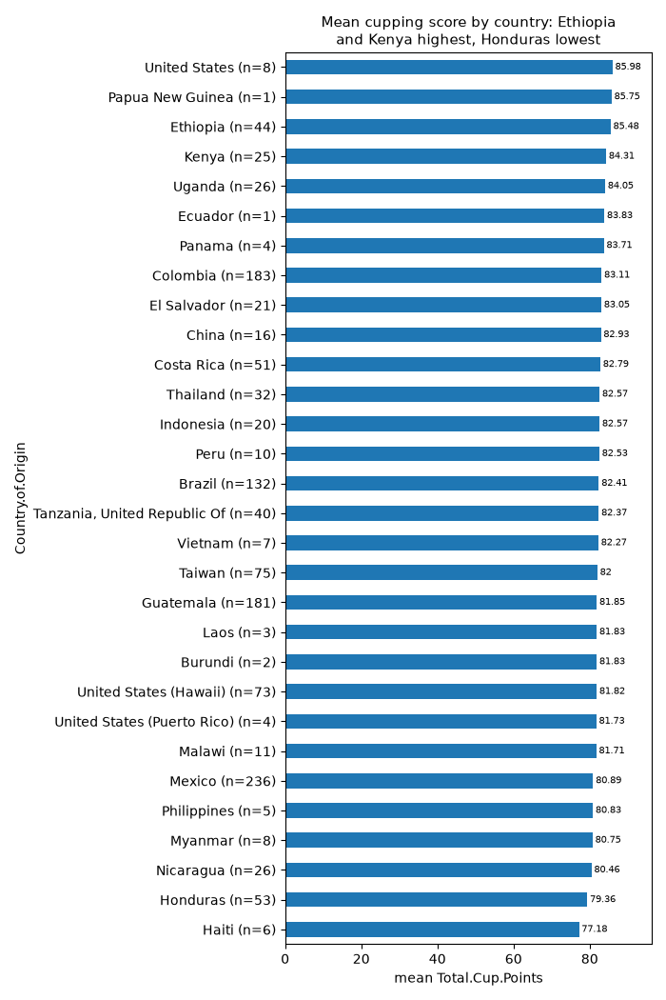

# CSV Analyst Agent

[](https://github.com/erenahmet17/csv-analyst-agent/actions/workflows/ci.yml)


**Give it a CSV and a question. It explores the data, tests what it finds, draws charts, and
writes a report you can share.**

The agent is Claude working through a small set of **typed analysis tools**. It never runs
generated code. It checks data quality first, backs every claim with a statistical test and an
effect size, looks at the charts it draws, and writes the report in the language of your
question.

> Türkçe özet en altta.

```bash
csvagent analyze sales.csv -q "Which factors are linked to high revenue?"
```

```
  [01] describe_dataset() -> ok
  [02] correlations(target=Revenue) -> ok
  [03] column_summary(column=Discount) -> ok
  [04] compare_groups(column=Revenue, group_by=Region) -> ok
  [05] plot(kind=box, x=Region, y=Revenue, title=...) -> ok
  ...
Done: 18 tool calls, 5 charts.
  markdown: reports/sales_20261105-1949/report.md
  html:     reports/sales_20261105-1949/report.html
```

## What you get

- **A report** in Markdown and as a single self-contained HTML file (charts embedded), with
  these sections: Summary, Data quality, Findings, Recommendations, Limitations.
- **Numbers you can check.** Every number must come from a tool result, and every tool call is
  logged with its input and output in `steps.jsonl`. The report ends with a table of all steps.
- **Statistics, not impressions.** Group differences come with Welch t / Mann-Whitney U /
  ANOVA / Kruskal-Wallis / chi-square, plus an effect size (Cohen's d, η² or Cramér's V), so
  "significant" and "important" are kept apart. Correlations come with a
  p-value and a **Benjamini-Hochberg FDR q-value**, so a finding that only looks significant
  because many things were tested is flagged as such.
- **Charts the model has actually seen.** Each chart goes back to the model as an image, so
  it describes what the chart shows instead of what it expected.
- **A CLI and a Streamlit app** where you watch the agent work step by step.

## Example

The [Coffee Quality Institute arabica ratings](https://github.com/jldbc/coffee-quality-database)
(1,311 coffee lots, 44 columns, MIT licensed) make a good test, because the data has several
traps:

```bash
csvagent analyze arabica_data_cleaned.csv -q "Analyze this coffee quality data. Check data \
quality first, then find the factors associated with the total cupping score (Total.Cup.Points), \
such as country, altitude, processing method, moisture and defects. ..."
```

In 21 tool calls (about 47k input and 6k output tokens) the agent caught every trap on its own.
Quoted from [the report](docs/example/report.md):

- **Impossible values:** "One lot has Total.Cup.Points = 0 … an error or placeholder" and
  altitudes of "1, 110,000 and 190,164 m. These are typos or unit errors."
- **Disguised missing values:** "252 lots (19%) have Moisture = 0. A grain moisture of exactly
  0 is not physically possible, so these are almost certainly missing values."
- **Leakage:** the sensory sub-scores "are components of the total, so the strong correlation
  is largely built in", and the `Unnamed: 0` column "has a Spearman correlation of −0.9999 with
  the score. The file is sorted by score, so the index must be excluded from any model."

And it tested what it found instead of eyeballing it:

- **Country matters most** among the requested factors: across the 19 countries with at least
  10 lots, "ANOVA p = 5.6e-24, Kruskal-Wallis p = 4.5e-47, eta² = 0.118". Ethiopia (85.5,
  n=44) and Kenya (84.3, n=25) lead. The 17 smaller countries were left out of the test.
- **Processing method barely matters:** "ANOVA p = 0.044 … but eta² = 0.008. Method explains
  less than 1% of the variance." Significant, but not important.
- **Altitude is non-linear and confounded:** Spearman r = 0.25. The score is flat up to about
  1,500 m and only rises above it, and "high-altitude countries such as Ethiopia and Kenya also
  score highest."

<p align="center">
  
</p>

Every number above comes from a logged tool call: see the
[full report](docs/example/report.md) and its [step log](docs/example/steps.jsonl).

## Quick start

Requires Python 3.10+ and an [Anthropic API key](https://console.anthropic.com/).

```bash
git clone https://github.com/erenahmet17/csv-analyst-agent.git
cd csv-analyst-agent
python -m venv .venv
# Windows: .venv\Scripts\activate    macOS/Linux: source .venv/bin/activate
pip install -e ".[app]"
cp .env.example .env        # Windows: copy .env.example .env
```

Then put your key in `.env`:

```
ANTHROPIC_API_KEY=sk-ant-...
# CSVAGENT_MODEL=claude-sonnet-5-5   (optional, the default model)
```

## Usage

### Command line

```bash
csvagent analyze data.csv
csvagent analyze data.csv -q "Kalp hastalığıyla en çok ilişkili faktörler neler?"
csvagent analyze data.csv --out reports/run1 --max-steps 30 --model claude-haiku-5-5
```

| Option | Default | What it does |
|---|---|---|
| `-q`, `--question` | general exploration | What you want to know |
| `--language` | detected from the question | Report language, e.g. `English`. English and Turkish questions are detected automatically. |
| `--out` | `reports/<name>_<time>` | Output folder |
| `--model` | `$CSVAGENT_MODEL` or `claude-sonnet-5-5` | Claude model to use |
| `--max-steps` | 20 | Max model turns (one turn can call several tools) |
| `--max-tokens` | 8192 | Max output tokens per turn. If the report is cut off, it is marked incomplete; raise this. |
| `--no-images` | off | Don't send charts back to the model (fewer tokens) |

### Web app

```bash
streamlit run app/streamlit_app.py
```

Upload a CSV, ask a question, and watch each tool call and chart as it happens. Then read the
report on the page or download it as HTML.

### Output

```
reports/<name>_<time>/
  report.md      the report + a table of every tool call
  report.html    one shareable file, charts embedded
  charts/*.png
  steps.jsonl    audit log: tool, input, output, duration, errors
```

CSV loading guesses the delimiter (`,` `;` tab `|`) and the encoding (UTF-8, UTF-8 with BOM,
Windows-1254 for Turkish, Latin-1).

## How it works

```
question + CSV
     │
     ▼
┌─────────────┐   tool_use: compare_groups(Age, HeartDisease)   ┌───────────────┐
│   Claude    │ ───────────────────────────────────────────────►│   Toolbox     │
│ (plans the  │                                                 │ pandas/scipy/ │
│  analysis)  │ ◄───────────────────────────────────────────────│ matplotlib    │
└─────────────┘   tool_result: "p=3e-12, Cohen's d=0.9" (+ PNG) └───────────────┘
     │   ... repeats until the model stops calling tools (or hits the step limit)
     ▼
report.md + report.html (charts embedded) + steps.jsonl (audit log)
```

The loop is written directly on the Anthropic Messages API, with no agent framework, so
every step is visible in [`agent.py`](src/csvagent/agent.py):

1. The model gets the task and the tool definitions as JSON schemas. The task states today's
   date, so recent timestamps are not mistaken for future dates, and names the report
   language explicitly, because "the language of the question" alone once produced a German
   report for an English question.
2. It replies with `tool_use` blocks. The loop runs each tool and sends all results back in
   one message as `tool_result` blocks. Charts go back as image blocks.
3. A failed call (a wrong column name, a missing chart argument) goes back with
   `is_error: true` and a helpful message, such as the list of valid columns, so the model
   corrects itself instead of the run crashing.
4. When the model answers without calling a tool, that answer is the report. At the step
   limit it is asked to write the report from what it already has. If the report is cut off
   at the token limit, it is flagged as incomplete rather than passed off as finished.

### Tools

| Tool | What it does |
|---|---|
| `describe_dataset` | Size, column types, missing values, distinct values, duplicates, sample rows |
| `column_summary` | Statistics or value counts for one column, including exact zeros (often disguised missing values) |
| `correlations` | Spearman/Pearson correlations with a target or the strongest pairs, each with p, FDR q and n |
| `group_stats` | A numeric column summarized per group |
| `crosstab` | Two categorical columns: counts and row percentages |
| `binned_rate` | Target mean per quantile bin of a numeric column (non-linear effects) |
| `find_outliers` | IQR outliers with bounds and the most extreme values |
| `compare_groups` | Welch t + Mann-Whitney U + Cohen's d, ANOVA + Kruskal-Wallis + η², or chi-square + Cramér's V. Groups too small to test are left out and listed. |
| `plot` | histogram, bar, box, scatter, heatmap, line: saved as PNG and returned to the model. Bars with many categories are drawn horizontally, sorted, with n and values. |

### Why typed tools instead of generated code?

Letting the model write pandas code is more flexible, but that code needs a sandbox, fails in
many ways, and is hard to audit. Typed tools validate their input, are safe to run on any
machine, and leave a log of exactly what was computed. The trade-off is that the agent can only
do what the toolbox offers. Adding a tool is one decorated function in
[`tools.py`](src/csvagent/tools.py).

The system prompt sets the working method: data quality first, test before you claim, say
"associated with" rather than "causes", and take every number from a tool result.

## Development

```bash
pip install -e ".[app,dev]"
pytest -q          # fake Anthropic client + synthetic data: no API key, no network
ruff check . && ruff format --check .
```

The agent tests replay scripted model responses and check the protocol details: tool results
go back in one user message in order, charts are sent as image blocks, tool errors are
returned instead of raised, the step limit forces a final report, and a report cut off at
`max_tokens` is flagged. The statistics are checked against scipy. CI runs lint and tests on
Python 3.10 and 3.12 on every push.

```
src/csvagent/
  data.py      CSV loading (delimiter and encoding detection), column kinds
  tools.py     the toolbox: typed analysis and chart tools with JSON schemas
  agent.py     the tool-use loop
  report.py    Markdown/HTML report and step log
  cli.py       `csvagent analyze`
app/streamlit_app.py
tests/
```

## Limitations and roadmap

- **No data cleaning yet.** The agent finds disguised missing values (like a cholesterol of 0)
  but cannot recode or filter them, so later tests still include them. Next step:
  `set_missing` and `filter_rows` tools.
- **No date parsing.** Date columns stay text, so trends over time are not analyzed.
- **Exploratory only.** No modelling, joins or time-series tools.
- **Cost grows with run length.** The whole history, charts included, is sent on every turn.
  Prompt caching is on the roadmap. `--no-images` and a smaller model reduce cost.
- **Treat reports from untrusted CSVs with care.** Cell values reach the model, and the HTML
  report does not sanitize the model's output yet.

---

## Türkçe özet

Bir CSV dosyasını ve bir soruyu alıp veriyi kendi başına analiz eden bir LLM ajanı. Model kod
çalıştırmıyor; yalnızca tipli ve güvenli analiz araçlarını çağırabiliyor, bu yüzden her adım
kayıt altında ve denetlenebilir.

- Önce veri kalitesine bakıyor: eksik değerler, tekrarlar, aykırı değerler, "0" gibi gizli
  eksikler.
- İddialarını istatistiksel testlerle (t-testi, Mann-Whitney, ANOVA, ki-kare) ve etki
  büyüklüğüyle destekliyor. Korelasyonlarda p-değeri ve çoklu karşılaştırma için FDR
  düzeltmeli q-değeri veriyor.
- Grafik çiziyor ve çizdiği grafiği görüntü olarak geri alıp yorumluyor.
- Sonunda bulgular, öneriler ve sınırlamalar içeren bir rapor yazıyor. Rapor sorunun dilinde
  (örneğin Türkçe) oluyor. HTML raporu grafikler gömülü tek bir dosya.
- Türkçe CSV'leri (`;` ayırıcı, Windows-1254 kodlaması) otomatik tanıyor.

Ajan döngüsü bir framework kullanılmadan, doğrudan Anthropic Messages API ile yazıldı.
