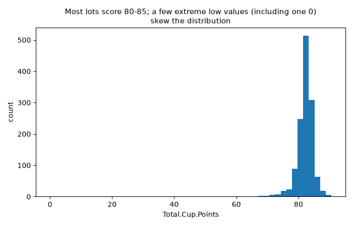
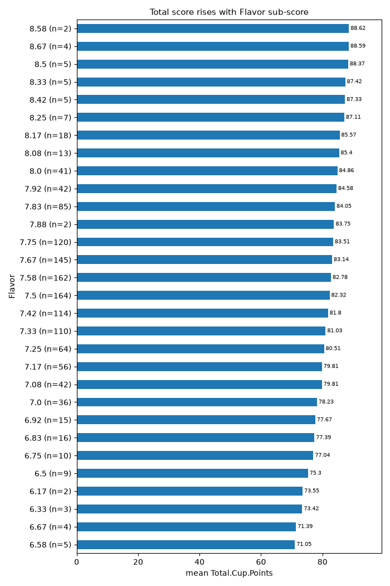
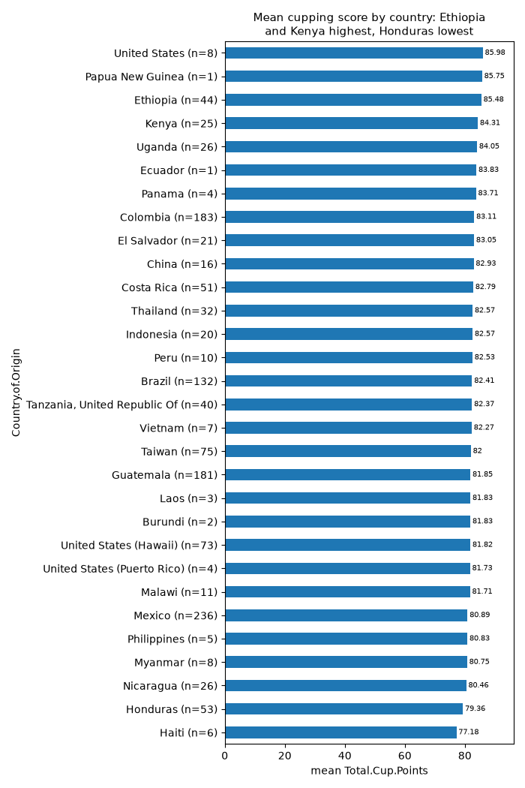
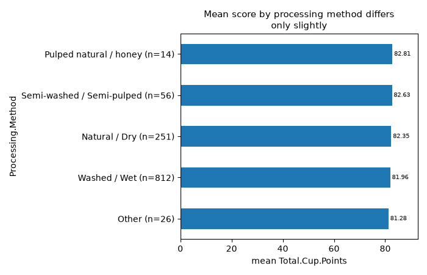
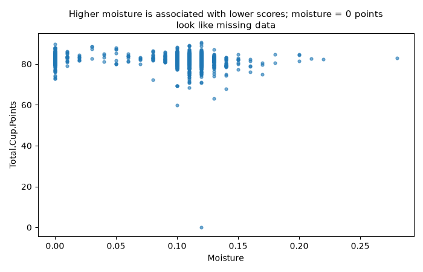
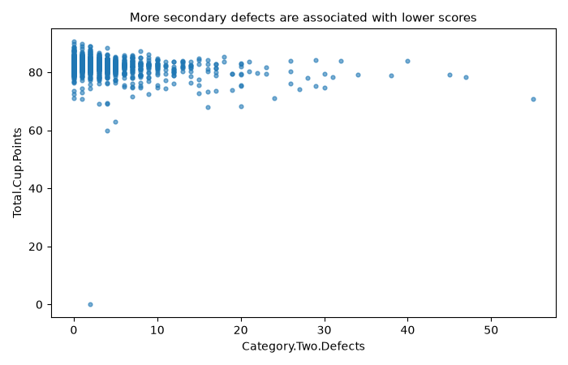

# Arabica coffee quality: what is associated with the total cupping score

## Summary
I analysed 1,311 arabica lots. The total cupping score (Total.Cup.Points) has a median of 82.5 and a mean of 82.12. Most lots fall between 81 and 84 points.

The score is most strongly associated with the sensory sub-scores. Flavor, Cupper.Points and Aftertaste have Spearman correlations of about 0.84–0.86. Among the factors you asked about, country of origin matters most (eta² = 0.118, a medium-to-large effect). Higher altitude, lower moisture and fewer defects are each associated with higher scores, but only weakly. Processing method has a statistically detectable but very small effect (eta² = 0.008).

## Data quality
- **Size and duplicates:** There are 1,311 rows and no duplicate rows. Species has only one value (Arabica), so it carries no information.
- **Impossible score:** One lot has Total.Cup.Points = 0. It sits at the Moisture ≈ 0.12 / Category.Two.Defects ≈ 2 position in the charts, so it is an error or placeholder. The minimum real scores are about 59.83 and 63.08. The IQR rule flags 74 low and high outliers (bounds 77.42–87.42). The 0 pulls the mean down and drives the skew (−10.5). It also distorts the Honduras mean (79.36, std 11.65, minimum 0).
- **Moisture:** 252 lots (19%) have Moisture = 0. A grain moisture of exactly 0 is not physically possible, so these are almost certainly missing values. I could not filter them with the tools, so the moisture results below include them and are probably diluted.
- **Altitude:**
  - 17% of altitude values are missing (227 rows).
  - There are 61 outliers by the IQR rule, with extreme values of 1, 110,000 and 190,164 m. These are typos or unit errors.
  - The mean altitude in metres is 1,784, but the median is 1,311 and the std is 8,767. The raw mean and std should not be used.
  - 111 rows are recorded in feet (maximum 1,859 in the "meters" column). I cannot tell whether those rows were converted correctly.
  - The altitude results below use rank correlation and quantile bins, which limits the damage from the outliers.
- **Other missing values:**
  - Processing.Method is missing for 11.6% of rows. The 152 rows with no method have a mean of 82.42 but a std of 7.17, because they include the 0-score lot.
  - Variety is missing for 15.3%, Color for 20.4%, Farm.Name for 27.2% and Lot.Number for 79.4%.
  - Text fields such as Harvest.Year, Altitude and Region are inconsistent. For example, Harvest.Year contains "2014" and "March 2010".
- **Row-order artefact:** The `Unnamed: 0` column (an index) has a Spearman correlation of −0.9999 with the score. The file is sorted by score, so the index must be excluded from any model.
- **Small groups:** 17 countries have fewer than 10 lots, and some have just 1. Their means are unreliable.
- **Score columns:** Uniformity and Sweetness are stored as categorical-like columns with few distinct values. Most lots probably score 10 on them.

## Findings

### 1. The score is concentrated around 82, with a few extreme low values

The histogram shows a narrow peak at about 80–85. The 0 appears as a lone bar far to the left, so I treat it as a data error.

### 2. Sensory sub-scores are the strongest correlates, and are partly part of the total
Spearman correlations with Total.Cup.Points (all q_fdr < 1e-200 for the first seven):

| Sub-score | r |
|---|---|
| Flavor | 0.86 |
| Cupper.Points | 0.86 |
| Aftertaste | 0.84 |
| Balance | 0.81 |
| Acidity | 0.77 |
| Aroma | 0.75 |
| Body | 0.73 |
| Clean.Cup | 0.36 |
| Uniformity | 0.35 |
| Sweetness | 0.19 |

The chart shows the mean total rising steadily with Flavor. It goes from about 71 at Flavor 6.58 to about 88.6 at Flavor 8.58.

These sub-scores are components of the total, so the strong correlation is largely built in. It does not show an independent driver.

### 3. Country of origin is the most important of the requested factors
Among the 19 countries with at least 10 lots, the means differ strongly (ANOVA p = 5.6e-24, Kruskal-Wallis p = 4.5e-47, eta² = 0.118).
- **Highest means:** Ethiopia 85.48 (n=44), Kenya 84.31 (n=25), Uganda 84.05 (n=26) and Colombia 83.11 (n=183).
- **Lowest means:** Honduras 79.36 (n=53, pulled down by the 0-score lot), Nicaragua 80.46 (n=26) and Mexico 80.89 (n=236).
- **Small groups:** The chart also shows "United States" at 85.98 (n=8) and Papua New Guinea at 85.75 (n=1). I would not rely on these.

### 4. Processing method has a statistically detectable but very small effect
Means by method:

| Method | Mean | n |
|---|---|---|
| Pulped natural / honey | 82.81 | 14 |
| Semi-washed | 82.63 | 56 |
| Natural / Dry | 82.35 | 251 |
| Washed / Wet | 81.96 | 812 |
| Other | 81.28 | 26 |

ANOVA p = 0.044 and Kruskal-Wallis p = 0.033, but eta² = 0.008. Method explains less than 1% of the variance. The differences are under 1.5 points, and the groups are small and unbalanced. I did not control for country, so some of this may reflect which countries use which method.

### 5. Moisture: higher moisture is associated with lower scores (weak to moderate)
- Spearman r = −0.206 (q_fdr = 6.8e-14, n=1311).
- Mean score by moisture bin:

| Moisture | Mean score | n |
|---|---|---|
| ≤ 0.10 | 82.63 | 524 |
| 0.10–0.11 | 82.07 | 381 |
| 0.11–0.12 | 81.78 | 284 |
| > 0.12 | 80.85 | 122 |

The top bin is about 1.8 points below the bottom bin. The bottom bin includes the 252 zero values that are probably missing, so the real relationship is likely somewhat different.

The scatter shows a column of points at moisture 0 (suspect values). Scores spread more widely at 0.10–0.13, and the few lots above 0.15 are mostly in the 75–85 range.

### 6. Defects: more secondary defects are associated with lower scores
- Category.Two.Defects: Spearman r = −0.171 (q_fdr = 5.8e-10).
- Category.One.Defects: r = −0.120 (q_fdr = 1.5e-05).
- Quakers: r = 0.021 (q_fdr = 0.44), which is not significant.
- Mean score by Category.Two.Defects bin:

| Category.Two.Defects | Mean score |
|---|---|
| 0–1 | 82.60 |
| 2–3 | 82.40 |
| 4–5 | 81.82 |
| more than 5 | 80.90 |

The chart shows a slight downward trend with a very wide spread. Many lots with 20 or more defects still score about 75–85.

### 7. Altitude: higher-altitude lots score higher, but this is confounded
- Spearman r = 0.252 (q_fdr = 5.8e-17, n=1084) for mean altitude.
- Mean score by altitude bin:

| Altitude (m) | Mean score |
|---|---|
| up to 995 | 81.82 |
| 995–1,200 | 81.55 |
| 1,200–1,311 | 81.69 |
| 1,311–1,500 | 81.49 |
| 1,500–1,750 | 82.89 |
| above 1,750 | 83.51 |

The rise only starts above about 1,500 m. Below that, the score is flat at roughly 81.5–81.8, so the relationship is non-linear. I made no altitude chart because the raw values contain absurd outliers up to 190,164. Altitude is probably entangled with country, because high-altitude countries such as Ethiopia and Kenya also score highest. I did not separate the two.

## Recommendations
1. **Clean the data before modelling:**
   - Drop or fix the 0-score lot.
   - Treat Moisture = 0 as missing and impute it, or add a "moisture missing" flag.
   - Cap or correct altitudes (for example, values above about 5,000 m are errors). Check the feet-to-metres conversion.
   - Standardise Harvest.Year and Region.
   - Merge or drop countries with fewer than 10 lots.
   - Remove the index column `Unnamed: 0`, and ID/text columns such as Owner, Lot.Number and Certification.Address.
2. **Decide what you want to predict.** If the goal is to understand drivers of quality, exclude the sub-scores (Flavor, Aroma and so on), since they are components of the total. Model only origin and post-harvest features: country, altitude, moisture, defects, processing method and variety.
3. **Model family:** Try gradient-boosted trees or random forests. They handle non-linear effects (such as altitude above 1,500 m), categorical variables with many levels, and missing values. Start from a regularised linear or mixed model with country as a random effect as an interpretable baseline. Use a robust loss, or remove the outliers, so the extreme low scores do not dominate.
4. **Investigate further:**
   - Fit a multivariable model to see whether altitude, moisture and processing remain associated with score once country is controlled.
   - Check whether the moisture effect holds after removing the zeros.
   - Examine whether Harvest.Year or the certifying body (In.Country.Partner) shifts scores. Graders may differ in how strict they are.

## Limitations
- This is observational data, so all findings are associations, not causes.
- Country, altitude and processing are likely confounded, and I tested each factor alone.
- Moisture and altitude contain disguised missing values and errors, which weaken those results.
- Many countries have very small samples.
- The data covers lots graded over a limited period, with scores given by different graders and organisations. It may not generalise to other coffee markets.

---
_Dataset: arabica_data_cleaned · model: claude-sonnet-5-5 · 21 tool calls in 5 turns · tokens in/out: 46764/6386 · 2026-11-05 23:05_

## Analysis steps

| # | Tool | Input | Result |
|---|---|---|---|
| 1 | `describe_dataset` |  | Dataset 'arabica_data_cleaned': 1311 rows x 44 columns, 0 duplicate rows. |
| 2 | `column_summary` | column=Total.Cup.Points | Total.Cup.Points (numeric, dtype float64), missing: 0 |
| 3 | `column_summary` | column=Moisture | Moisture (numeric, dtype float64), missing: 0 |
| 4 | `column_summary` | column=altitude_mean_meters | altitude_mean_meters (numeric, dtype float64), missing: 227 |
| 5 | `find_outliers` | column=altitude_mean_meters | altitude_mean_meters: 61 outliers of 1084 (5.6%). Bounds [350, 2350]. Most extreme: 1, 190 |
| 6 | `find_outliers` | column=Total.Cup.Points | Total.Cup.Points: 74 outliers of 1311 (5.6%). Bounds [77.42, 87.42]. Most extreme: 0, 59.8 |
| 7 | `correlations` | target=Total.Cup.Points | spearman correlation with Total.Cup.Points (p: test of r = 0; q_fdr: p adjusted for the 19 |
| 8 | `group_stats` | group_by=Country.of.Origin, column=Total.Cup.Points | Total.Cup.Points by Country.of.Origin: |
| 9 | `group_stats` | group_by=Processing.Method, column=Total.Cup.Points | Total.Cup.Points by Processing.Method: |
| 10 | `group_stats` | group_by=unit_of_measurement, column=altitude_mean_meters | altitude_mean_meters by unit_of_measurement: |
| 11 | `binned_rate` | column=Moisture, target=Total.Cup.Points, bins=6 | Mean of Total.Cup.Points by Moisture quantile bin: |
| 12 | `binned_rate` | column=Category.Two.Defects, target=Total.Cup.Points, bins=5 | Mean of Total.Cup.Points by Category.Two.Defects quantile bin: |
| 13 | `compare_groups` | column=Total.Cup.Points, group_by=Processing.Method | Total.Cup.Points by Processing.Method: Pulped natural / honey: mean 82.81 (n=14), Semi-was |
| 14 | `compare_groups` | column=Total.Cup.Points, group_by=Country.of.Origin, min_group_size=10 | Total.Cup.Points by Country.of.Origin: Ethiopia: mean 85.48 (n=44), Kenya: mean 84.31 (n=2 |
| 15 | `binned_rate` | column=altitude_mean_meters, target=Total.Cup.Points, bins=6 | Mean of Total.Cup.Points by altitude_mean_meters quantile bin: |
| 16 | `plot` | kind=histogram, x=Total.Cup.Points, title=Most lots score 80-85; a few extreme low values (including one 0) skew the distribution, bins=50 | Saved chart charts/01_histogram_Total_Cup_Points.png. Reference it in the report as ![Most |
| 17 | `plot` | kind=bar, x=Country.of.Origin, y=Total.Cup.Points, title=Mean cupping score by country: Ethiopia and Kenya highest, Honduras lowest | Saved chart charts/02_bar_Country_of_Origin_Total_Cup_Points.png. Reference it in the repo |
| 18 | `plot` | kind=bar, x=Processing.Method, y=Total.Cup.Points, title=Mean score by processing method differs only slightly | Saved chart charts/03_bar_Processing_Method_Total_Cup_Points.png. Reference it in the repo |
| 19 | `plot` | kind=scatter, x=Moisture, y=Total.Cup.Points, title=Higher moisture is associated with lower scores; moisture = 0 points look like missing data | Saved chart charts/04_scatter_Moisture_Total_Cup_Points.png. Reference it in the report as |
| 20 | `plot` | kind=scatter, x=Category.Two.Defects, y=Total.Cup.Points, title=More secondary defects are associated with lower scores | Saved chart charts/05_scatter_Category_Two_Defects_Total_Cup_Points.png. Reference it in t |
| 21 | `plot` | kind=bar, x=Flavor, y=Total.Cup.Points, title=Total score rises with Flavor sub-score | Saved chart charts/06_bar_Flavor_Total_Cup_Points.png. Reference it in the report as ![Tot |
